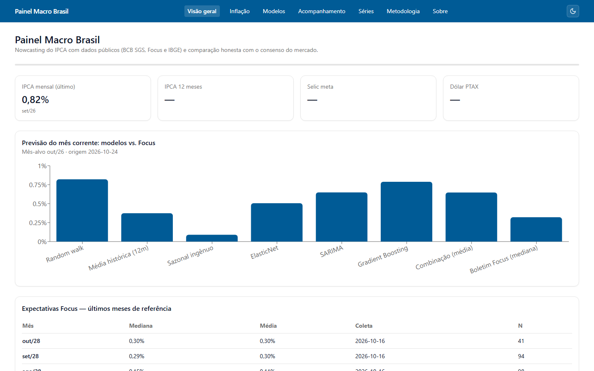
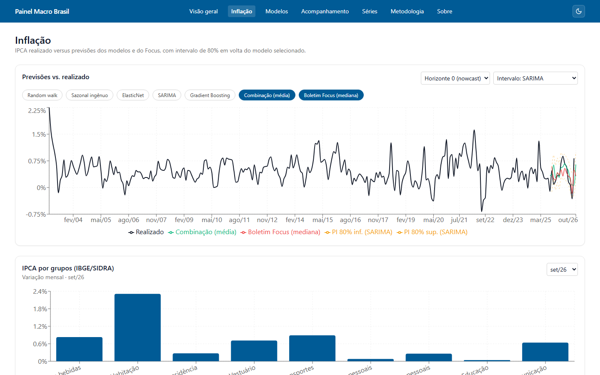
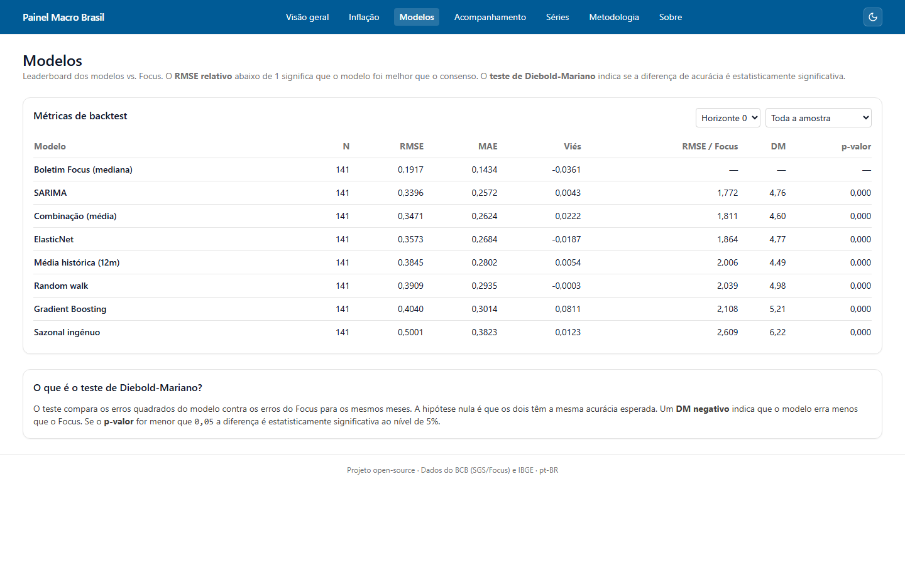
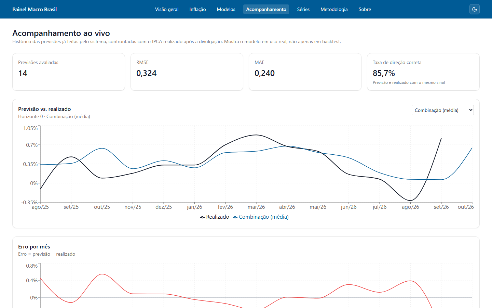
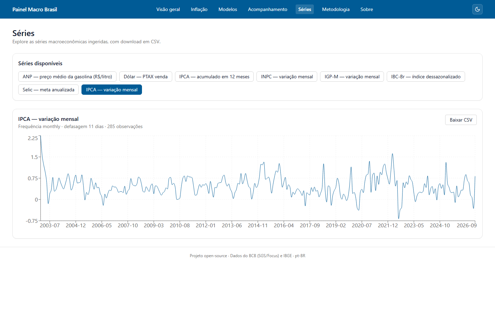
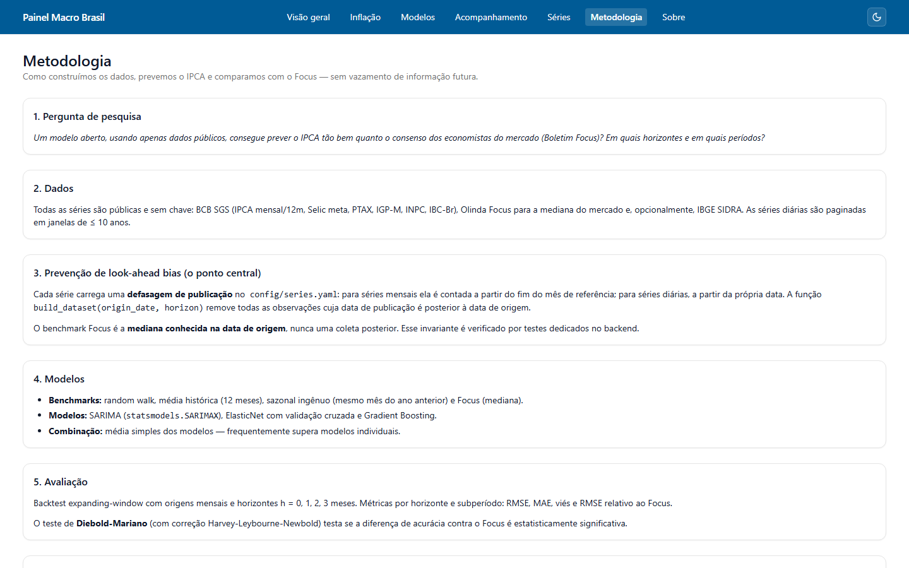
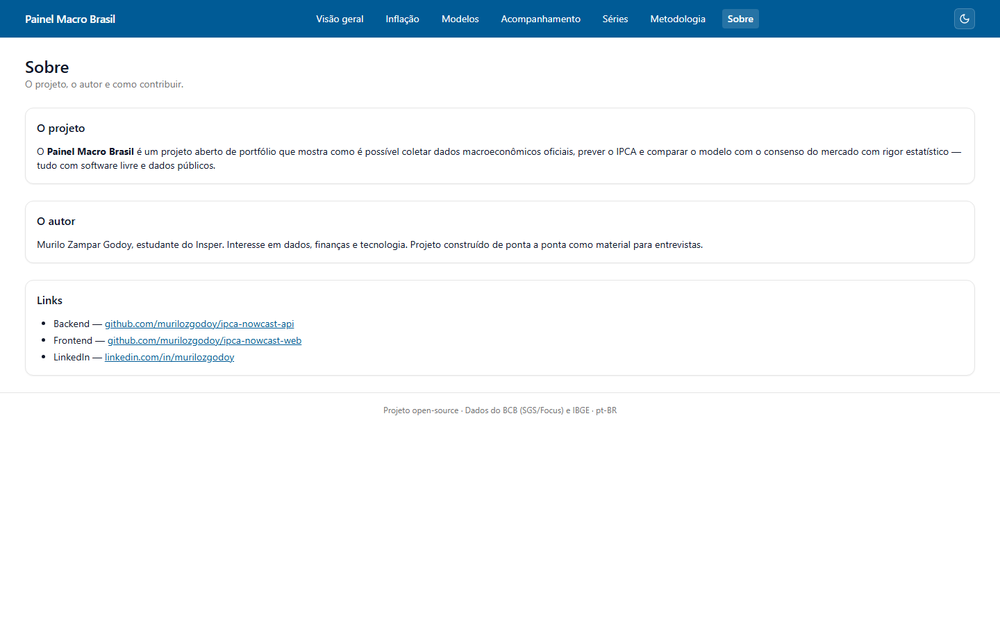

# ipca-nowcast-web

**Painel Macro Brasil** — React dashboard that visualises the IPCA nowcast
produced by [`ipca-nowcast-api`](https://github.com/murilozgodoy/ipca-nowcast-api)
and compares it with the Boletim Focus consensus.

> **Central question**
> _Can an open model, using only public data, forecast the IPCA as well as the
> consensus of market economists? At which horizons, and in which periods?_

Status: ✅ **feature-complete** (F0–F11 shipped) — see the backend's
[`PROGRESS.md`](https://github.com/murilozgodoy/ipca-nowcast-api/blob/main/docs/project/PROGRESS.md)
and [`FINAL_REPORT.md`](https://github.com/murilozgodoy/ipca-nowcast-api/blob/main/docs/project/FINAL_REPORT.md).

## Screenshots

Full-page captures of every route (generated with Playwright in
[`tests/e2e/screenshots.spec.ts`](tests/e2e/screenshots.spec.ts); run
`pnpm exec playwright test tests/e2e/screenshots.spec.ts` to refresh).

| Page                                                                       | Preview                                              |
| -------------------------------------------------------------------------- | ---------------------------------------------------- |
| `/` — Visão geral: KPIs, nowcast dos modelos vs. Focus, expectativas Focus |               |
| `/inflacao` — IPCA realizado vs. modelos vs. Focus, PI 80%, grupos SIDRA   |              |
| `/modelos` — Leaderboard de backtest com RMSE, MAE, viés e Diebold-Mariano |                |
| `/acompanhamento` — Histórico ao vivo: RMSE, MAE, taxa de direção correta  |  |
| `/series` — Explorador de séries macro com download CSV                    |                  |
| `/metodologia` — Pipeline, anti-look-ahead, limitações                     |        |
| `/sobre` — Autor e links                                                   |                    |

## Stack

- React 18 + Vite 5, TypeScript (strict) with `pnpm`
- Routing: React Router v6
- Data: TanStack Query + `zod` validation, aligned with the backend OpenAPI
- UI: Tailwind CSS with a shadcn/ui-flavoured design system; light/dark theme
- Charts: Recharts
- Mocks: Mock Service Worker (MSW) with fixtures copied from the real API
- Testing: Vitest + Testing Library (unit), Playwright (smoke e2e)
- Lint: ESLint 9 flat config + Prettier
- Dashboard copy in pt-BR with Brazilian number formatting

## Quick start

```bash
# 1. install deps
pnpm install

# 2. configure the environment
cp .env.example .env   # set VITE_API_URL / VITE_USE_MOCKS

# 3. run against MSW mocks (no backend needed)
VITE_USE_MOCKS=true pnpm dev

# or run against the local FastAPI backend
pnpm dev
```

Build for production:

```bash
pnpm build
pnpm preview
```

## 🇧🇷 Resumo em português

Dashboard em React/TypeScript do **Painel Macro Brasil**. Mostra KPIs
(IPCA, Selic, dólar), a **previsão do mês corrente** feita pelos modelos
versus a mediana do Boletim Focus, o leaderboard dos modelos com o resultado
do teste de Diebold-Mariano explicado em linguagem simples e um explorador de
séries. Toda a UI é em português do Brasil, com números no formato brasileiro.
Em modo mock (`VITE_USE_MOCKS=true`), o app funciona sem o backend graças ao
MSW com fixtures geradas do próprio backend.

## License

MIT.
